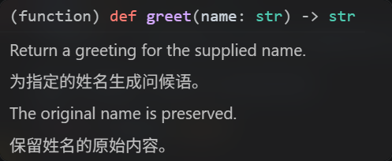
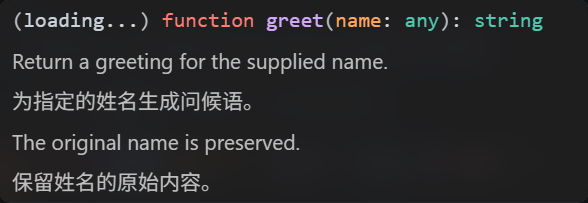

# 原生 Hover 接管可行性：源码与实测

日期：2026-11-01。范围：只做调研及隔离原型，正式插件仍为0.2.1，未修改用户常用窗口配置、未调用云端模型。

## 结论

**可以实现用户要求的“英文段落下直接插入中文，英文只出现一次”，也能实现“正文仅中文”。但需要明确启用提案 API，不能作为普通稳定公共 API 功能。**

本机 Windows VS Code **1.144.0** 上，不仅隔离开发宿主验证成功，隔离的普通扩展加载方式也通过，扩展运行模式确认为 `ExtensionMode.Production`。后者未使用 `--extensionDevelopmentPath`，将实验扩展放入专用扩展目录并显式使用 `--enable-proposed-api local-research.hover-takeover-prototype`。不是将当前0.2.1安装包直接升级就会获得的能力。

建议下一步做可选的自用实验模式，保留现有稳定API模式作为兼容回退。正式产品实施需另行设计失败回退、等待体验与版本检测；本次原型没有接入用户DeepSeek Key。

## 1. 已验证的实现路径

1. 扩展清单声明 `enabledApiProposals: ["documentFiltersExclusive"]`，由实验启动参数对指定扩展显式放行。
2. 通过 `DocumentFilter.exclusive: true` 注册 Python/JavaScript HoverProvider；编辑器普通查询只选择匹配的独占提供者。
3. 提供者内部调用 `vscode.experimental.executeHoverProvider_recursive` 读取普通语言提供者原文。该命令跳过所有独占提供者，因此不会再次进入自身。
4. 用本地固定译文将受控样例变为“原文A、译文A、原文B、译文B”，仅返回一个Hover；原生语言文档不再独立追加第二份。
5. 仅中文模式把受控样例的自然语言段落替换成中文，保留函数签名。

这是**重新提供一份完整的悬停文档**，不是直接编辑已渲染的 Pylance DOM。无需改写 VS Code 安装文件、注入CSS或替换Pylance。

`exclusive` 是明确的提案API字段，不应含糊称为随意使用的隐藏字段。字段定义见 [提案声明](https://github.com/microsoft/vscode/blob/2c33b50b16c472efe58357d1d2a8a5414bc23fbf/src/vscode-dts/vscode.proposed.documentFiltersExclusive.d.ts)；运行时检查见 [checkSelector](https://github.com/microsoft/vscode/blob/2c33b50b16c472efe58357d1d2a8a5414bc23fbf/src/vs/workbench/api/common/extHost.api.impl.ts#L324)。

独占/跳过行为见 [语言功能注册表](https://github.com/microsoft/vscode/blob/2c33b50b16c472efe58357d1d2a8a5414bc23fbf/src/vs/editor/common/languageFeatureRegistry.ts#L152)。实验查询包装及类型转换见 [extHostApiCommands](https://github.com/microsoft/vscode/blob/2c33b50b16c472efe58357d1d2a8a5414bc23fbf/src/vs/workbench/api/common/extHostApiCommands.ts#L144)。

## 2. 实测环境与结果

| 环境项 | 值 |
| --- | --- |
| VS Code | 1.144.0 / `2c33b50b16c472efe58357d1d2a8a5414bc23fbf` |
| Python扩展 | 2026.10.0 |
| Pylance | 2026.4.1 |
| 内置JS/TS扩展 | 10.0.0 |
| 翻译 | 两段固定中文，无网络模型请求 |
| 用户数据/扩展目录 | 全部在项目 `.vscode-test/takeover*` 下隔离 |
| 正式翻译扩展 | 原型断言未加载，正式源码与0.2.1包不变 |

| 场景 | 结果 |
| --- | --- |
| 未声明/启用proposal直接注册exclusive | 注册被明确拒绝，不存在“直接写字段就能用”的稳定版捷径 |
| 声明proposal并显式放行，开发宿主 | Python/JS均通过 |
| 无开发标志、专用目录普通加载，显式放行 | Python/JS均通过，记录模式为production |
| 原文段落后插入译文 | 实际原生窗口DOM中每段英文/中文各出现一次；只有一个返回Hover |
| 仅中文正文 | 指定英文段落不再出现，中文存在 |
| 自递归 | 每次普通查询调用接管provider一次，内部采集未重入 |
| Python/JS同时查询 | 两次请求均成功，各一次provider回调 |
| 标准库原文读取 | pathlib.Path、Node EventEmitter 可读，未验证其全文翻译质量 |
| 补全/参数提示/跳转定义 | 两种语言的greet样例均保留；参数提示前后均为一项 |
| 模拟翻译失败、显式返回已采集原文 | 原文出现一次，中文不出现 |
| 独占provider直接返回undefined | 原文也消失，**不会自动回退** |
| 普通第三方Hover提供者 | 内容可经recursive采集并聚合一次 |
| 第二个独占Hover提供者 | recursive跳过它；本次实测竞争者胜出、我们的译文不显示 |
| decoration附加Hover | 仍可显示；独占语言文档不等于独占整个悬停窗口 |
| 注销接管provider | 后续查询恢复原生英文 |

实际截图（受控固定译文，不是效果图）：

普通加载模式完整机器可读记录：[results-installed.json](experiments/hover-takeover/evidence/results-installed.json)。

## 3. 使用与发布限制

官方文档将提案API定义为不稳定能力，推荐在Insiders使用；允许私下分享VSIX并额外启用，但不应用于Marketplace发布。[官方说明](https://code.visualstudio.com/api/advanced-topics/using-proposed-api)

本次稳定版1.144.0显式放行成功，是特定版本的实测结果，不能替代跨版本支持承诺。当前源码中指定扩展的CLI白名单分支确实允许清单所声明的提案，不要求开发模式；见 [extensionsProposedApi.ts](https://github.com/microsoft/vscode/blob/2c33b50b16c472efe58357d1d2a8a5414bc23fbf/src/vs/workbench/services/extensions/common/extensionsProposedApi.ts#L91)。

本次未将原型打包/发布到Marketplace，普通模式是将解包扩展放入隔离目录加载，**不是VSIX安装流程测试**。没有为用户修改argv.json或常用启动快捷方式。

## 4. 接管模式的实质代价

### 首次等待

模拟1500ms翻译延迟，在350ms观察实际窗口时，原文和译文都尚未出现；完成后才显示整份中英对照。这与现有“原文先显示、译文随后加入”不同。单次HoverProvider返回值没有稳定的多次更新协议。

产品化需选择：等待一个有上限的翻译结果，或到达阈值先返回原文、后台完成后下次悬停使用缓存。不能同时承诺原文立即显示、译文原地追加、无重复且完全采用单次稳定接口。强制重新触发悬停也可能干扰焦点，尚未验证。

### 错误和取消

必须对超时、无密钥、无同意、暂停、模型错误等明确返回原文或解除接管；简单返回undefined会把原生文档一并抑制。底层采集命令使用CancellationToken.None，仍需保留取消/过期结果保护，不能沿用“返回空即可保留其他provider”的当前降级假设。[getHover.ts](https://github.com/microsoft/vscode/blob/2c33b50b16c472efe58357d1d2a8a5414bc23fbf/src/vs/editor/contrib/hover/browser/getHover.ts)

### 共存与内容保真

- recursive排除所有exclusive提供者，不只排除本插件，其他接管插件不能保证兼容。
- 多个普通provider的聚合数组按完成顺序返回，未提供原生provider排序身份，不能保证与默认窗口顺序一致。
- 诊断和decoration可独立贡献内容；本次目标应限定为“语言文档不重复”。[原生Hover参与者](https://github.com/microsoft/vscode/blob/2c33b50b16c472efe58357d1d2a8a5414bc23fbf/src/vs/editor/contrib/hover/browser/markdownHoverParticipant.ts)
- 正式版需要处理完整AST、range、baseUri、链接安全、代码保护、表格与列表；原型只替换两个已知句子。
- JS/TS服务的VerboseHover展开/收起功能可能在重建普通Hover时丢失，尚未覆盖。[内置Hover实现](https://github.com/microsoft/vscode/blob/2c33b50b16c472efe58357d1d2a8a5414bc23fbf/extensions/typescript-language-features/src/languageFeatures/hover.ts)

## 5. 其他路线

| 路线 | 判断 |
| --- | --- |
| 通用LSP middleware | 只能改写自己管理的LanguageClient；未找到向现有Pylance注入全局Hover middleware的公开接口。JS/TS内置扩展也不是该LSP客户端 |
| TypeScript Language Service Plugin | JS单语言有潜力改写QuickInfo，但接口同步，云翻译需要缓存/预取/重触发；尚未实测，且不覆盖Python |
| Pylance内建翻译 | 有autoTranslateDocstrings，要求Copilot Chat及supportRestructuredText；不等同用户指定DeepSeek Key，未验证逐段双语效果 |
| 独立阅读面板 | 可完全控制内容，但不是用户偏好的原生悬停交互 |
| 关闭editor.hover.enabled | 控制整体鼠标悬停触发，不能仅去掉英文并保留我们的自动悬停 |

参考：[LSP Hover middleware源码](https://github.com/microsoft/vscode-languageserver-node/blob/a0981e3d9c68397553696b0fb2bebb9dd024e4ba/client/src/common/hover.ts)、[TS插件官方说明](https://github.com/microsoft/TypeScript/wiki/Writing-a-Language-Service-Plugin)、[Pylance官方说明](https://github.com/microsoft/pylance-release/blob/f03a84d93009b8a8398658c365f72b46afbb2482/README.md)。

## 6. 建议与本轮交付

建议把接管路线作为**可选自用实验版**继续设计：显式启用、支持原文在上译文在下/仅中文、短等待预算、失败返回原文、一键退回当前兼容模式。先保持正式0.2.1不变，不默认切换所有用户。

源码与复现入口：[experiments/hover-takeover](experiments/hover-takeover/README.md)。这些文件位于既有VSIX排除的docs目录，不会进入正式插件。

研究由主代理完成隔离实验、截图检查与归档；独立研究代理核对提案声明、运行时门禁、实验命令、失败边界及替代路线。没有进行生产实现、付费模型测试、远程窗口测试或跨VSCode版本测试。

## 7. 原型过程记录

1. 无提案声明注册被拒绝，保存为takeover-no-proposal.log。
2. 首次将实验脚本留在临时扩展目录外，API归属变为nullExtensionDescription；将实验脚本与样例复制进隔离扩展后修正。这是测试路径归属问题，不是绕过提案门禁。
3. 参数提示最初查询位置在字符串内部返回undefined；调整到调用参数起点，并对照接管前后结果，两个语言均一项。
4. 最终开发宿主和普通加载模式均成功。日志和原始结果留在 `.vscode-test/takeover*`，可复核证据另存docs。
