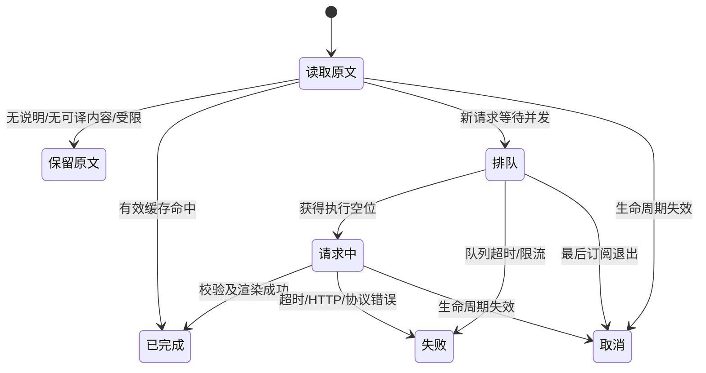

# 悬浮翻译 0.5.0 详细设计（待实施）

日期：2026-11-02（Asia/Shanghai）\
实现基线：`87179c6a391a81a3876088a935a6136af05d9808`，当前版本 0.4.0。\
范围依据：[下一阶段路线图](next-stage-roadmap.md)及用户确认：围绕等待体验、配置诊断、译文质量进入详细设计；复杂分片和自动刷新独立验证。

本文是建议采用的实施蓝图，接口均为拟议接口。本轮不修改代码、测试、设置、版本或安装包，不发送真实 API 请求。0.5.0 是目标版本，当前产品仍为 0.4.0。

## 1. 设计结论与交付范围

采用“现有两种 Hover 通路 + 小型任务状态记录 + 同一翻译协调器 + 本地诊断/显式连接测试 + 质量样本集”。不新增 Webview、独立翻译引擎、后台预取或文档持久化。

| 目标 | 0.5.0 交付 | 不包含的行为 |
| --- | --- | --- |
| G1 等待体验 | 读取/排队/翻译/后台/完成/跳过/失败可区分；主动查看光标处文档 | 后台完成后自动打开或刷新 Hover；强制重新翻译 |
| G2 配置诊断 | 零 HTTP 本地检查、固定样本连接测试、可预览的脱敏摘要 | 启动即探测、配置即探测、多服务管理 |
| G3 译文质量 | 30 例分层样本、结构与语义分别验收、有证据才改内置提示词 | 凭 JSON 正确率宣称语义准确；任意系统提示词覆盖 |
| G4/G5 | 单独的验证计划与进入/停止门槛 | 不进入 0.5.0 默认代码路径，不阻塞核心版本 |

保留目前的稳定追加默认模式、实验接管选择、显示方式及语言范围。保留“不重复追加整份原文”的行为，不恢复“中文翻译”“完整原文”等标题。

### 1.1 备选方案与取舍

| 方案 | 优点 | 代价 | 决定 |
| --- | --- | --- | --- |
| 仅补中文错误提示 | 改动最少 | 无法区分采集、队列与后台完成 | 不足以满足三个目标 |
| 现有链路增加有限状态和诊断 | 重用取消、缓存、安全协议；可逐步验收 | 需要理清任务状态与服务状态 | 推荐 |
| 新建统一文档服务/固定阅读面板/自动刷新层 | 更自由的展示 | 新生命周期、交互及权限边界，范围明显扩大 | 后置 |

与对标产品一致的是提供加载、完成和失败恢复路径。上游依赖 IntelliJ 的 `DocumentationResult.updates` 更新内容；VS Code 的 `HoverProvider` 返回一次结果，不能直接移植该更新机制。[上游固定源码](https://github.com/YiiGuxing/TranslationPlugin/blob/bb50b0f4debe5464ffe99ede63c95e5456862bb7/src/main/kotlin/cn/yiiguxing/plugin/translate/documentation/TranslatableDocumentationTarget.kt#L82)、[VS Code HoverProvider](https://code.visualstudio.com/api/references/vscode-api#HoverProvider)。

## 2. 当前实现事实与必须保留的约束

1. 稳定模式通过 `HoverDiscoveryCoordinator` 读取原文，忙碌门禁阻止递归；消费端取消后，原文命令尚未结束仍占有采集租约。
2. 接管模式先读原文，默认再等译文 2.5 秒；到期返回原文，同时由 provider 继续持有后台订阅。文档编辑/关闭、单元格移除、配置/权限变化及退出仍应取消后台任务。
3. `TranslationCoordinator` 已承担请求合并、缓存、队列、并发、频率和阻断。新功能必须复用它；不得直接从命令绕过协调器调用客户端。
4. `refresh()` 当前同时取消任务、清缓存、清服务阻断。引入诊断后需要把最后一项变为明确选择，避免普通设置变化意外解除保护。
5. 代码/格式由占位符和 AST 保护；模型输出严格校验。复杂 Markdown 仍可能整片保留原文，这不是可以简单放宽 URL 白名单解决的问题。
6. 状态栏当前主要记录活动数和最后错误；它不能证明鼠标在哪、Hover 是否可见，甚至不能证明 provider 调用来自鼠标。

## 3. G1：等待体验与主动查看

### 3.1 用户可见设计

继续保留右侧一个状态栏项；点击打开现有菜单。只在处理期间使用旋转图标；不为每次悬停弹通知。轻量进度与短文案符合[官方状态栏建议](https://code.visualstudio.com/api/ux-guidelines/status-bar)。

| 状态 | 状态栏示例 | 提示/菜单中的解释 |
| --- | --- | --- |
| 空闲、可尝试 | `悬浮翻译` | 配置检查通过；接口尚未测试，或上次测试的时间与结果 |
| 读取原文 | `悬浮翻译 · 读取中` | 最近文档请求正在等待语言服务 |
| 排队 | `悬浮翻译 · 排队中` | 等待本插件并发空位；队列等待上限 3 秒 |
| HTTP 处理中 | `悬浮翻译 · 翻译中` | 最近文档请求正在等待服务响应 |
| 接管先返回原文 | `悬浮翻译 · 后台翻译` | 已先显示原文；完成后请重新悬停查看 |
| 完成 | `悬浮翻译 · 已完成` | 最近一次翻译已完成；后台结果请重新悬停查看 |
| 无说明/不可翻译 | `悬浮翻译` | 未读到文档，或没有可翻译文字；列出实际观测原因 |
| 部分保留 | `悬浮翻译` | 部分内容因字符预算或保真限制保留原文 |
| 服务阻断/冷却 | `悬浮翻译 · 需检查` | 显示具体原因和可执行动作；冷却剩余时间 |
| 主动连接测试 | `悬浮翻译 · 测试中` | 正在验证固定样本；与文档翻译分开标记 |

聚合提示包含“运行 N、排队 M”，N/M 统计实际任务而非订阅人数；不把多个相同请求显示为多次计费。近期任务结果描述为“最近文档请求”，不使用“当前鼠标处”。

完成提示最多保留 5 秒，遇新请求、文档失效、模式切换、清缓存或配置失效立即清除。它是完成事实，不保证缓存永远存在；仅在本次 `acquire` 确实命中缓存时标记“缓存命中”。不为此增加缓存索引或文档历史库。

优先级：环境/凭据/服务阻断 > 主动测试状态 > 当前活动文档任务 > 最近有效结果 > 就绪/暂停。活动计数在提示中始终可见。模式回退另列一行，不覆盖任务错误。成功清除同配置代际的旧临时错误；成功不能清除并发产生的有效 401 阻断或 429 冷却。

### 3.2 主动查看命令的精确定义

新增 `hoverDocsTranslator.showCurrentHover`，名称 **“悬浮翻译：查看光标处文档翻译”**。菜单解释：“针对编辑器插入光标；后台完成后也可移开鼠标重新悬停。”不默认绑定新快捷键。

1. 取当前活动文本编辑器、文档版本、`selection.active`；Notebook 必须是受支持的活动 Python 代码单元格。
2. 没有活动编辑器/不支持范围，返回明确本地说明；不猜测上次鼠标位置，也不切换或打开文件。
3. 如果同 URI、版本、位置、有效配置代际已有活动任务，只显示其当前状态，不中断订阅、不先隐藏再重开 Hover。
4. 暂停、缺配置/密钥/同意、服务阻断时展示对应恢复动作，不借此绕过自动翻译开关或发送授权。
5. 其余情形由本次用户动作调用 `editor.action.showHover`，参数建议 `{ focus: 'noAutoFocus' }`。仍由现有 provider 采集、缓存命中或请求合并；命令不直接收集后再发一次翻译。
6. 不在异步翻译完成回调中再次执行该命令。不调用 hide/show 组合、不改光标、不强制焦点、不创建持续“打开意图”。

Key/权限检查等若跨越 `await`，执行 `showHover` 前必须复核同一活动编辑器对象、URI、版本、`selection.active`、配置 revision 与模式代际。任何一项改变则取消本次显示，不让针对 A 的命令作用于新 B，也不把用户拉回 A。

`showHover` 的当前官方实现从编辑器插入光标触发，支持 `noAutoFocus`；辅助功能开启时仍由编辑器决定焦点行为。这是需要在目标 VS Code 版本实测的命令行为，不是“强制刷新当前窗口”的公共保证。[官方实现](https://github.com/microsoft/vscode/blob/main/src/vs/editor/contrib/hover/browser/hoverActions.ts)

验收只承诺用户主动触发原生查看、复用有效缓存与在途任务。同一窗口已显示时不承诺一定重新计算；提示用户移开后重新悬停。此入口主要增加可发现性和状态解释，不引入第二套阅读器。

### 3.3 状态模型、身份与所有权

新增纯内存 `HoverActivityTracker`，提供状态归并；不拥有 HTTP，不决定取消，不保存原文或译文。

```ts
// 拟议契约；最终命名可随现有代码风格调整。
type Stage = 'collecting' | 'queued' | 'requesting';
type Outcome = 'completed' | 'no_document' | 'no_translatable_text'
  | 'preserved' | 'failed' | 'cancelled';
interface HoverTarget {
  uri: string; version: number; line: number; character: number;
  revision: number; modeGeneration: number; notebookUri?: string;
}
interface ActivityHandle {
  stage(value: Stage): void;
  background(): void; // 展示状态，与 queued/requesting 阶段正交
  finish(outcome: Outcome, detail?: SafeDetail): void;
}
// SafeDetail 仅含枚举原因、计数、耗时、cache/shared 标记。
// begin(target) 分配单调 operationId；snapshot() 返回不可变摘要。
```

- 身份必须包含单元格 URI，不能只用 notebook URI。源采集与任务订阅可以不同；同 HTTP 的多个消费者各有自己的 activity handle。
- 稳定 provider 在递归/忙碌门禁之后才开始记录；递归短路不产生“无文档”或覆盖外层状态。采集租约仍在 draining 时，在本地诊断显示“前次采集尚未结束”。
- 接管 provider 在范围、token 校验后开始记录；源采集失败触发既有模式回退，结束旧模式 activity。
- 各 provider 沿用原有 controller/有效性检查；记录器观察结果，不改变取消规则。接管超时仅置 `background=true`，不把工作标记为结束。
- 稳定模式取消后停止订阅；接管已返回原文后的订阅由 provider 持有。相同任务一个订阅取消不影响其他订阅，最后一个取消才中止 HTTP。
- 只选当前活动文档中最近开始且有效的请求显示细节。旧 A 晚于 B 完成不能覆盖 B；来自非活动文档的请求只计聚合活动。无法识别其他扩展主动调用，始终用“请求”措辞。
- 活动编辑器或主选择区变化时增加独立 `viewEpoch` 并清除展示归属；已脱离归属的旧请求随后完成也不能自动重新选中。此操作只影响展示，不额外取消 provider 持有的后台工作；新请求或用户针对同目标的主动查看才能建立新的展示归属。新 B 锁定展示 operationId 后，即使 B 完成/提示到期，也不退回展示尚在途的旧 A。
- 编辑/关闭/单元格删除、配置 revision 变化、模式 generation 变化立即使对应记录失效。晚到事件不再改 UI。`finish` 幂等，所有出口包括异常均结束记录。
- 已结束记录只留一个近期摘要；活跃记录受现有并发/队列和 provider 容量限制。停止/取消记录不写错误通知。



接管展示期限到达不属于终态：排队/请求中仍继续，但显示“后台翻译”。成功仅在有效性检查、校验及渲染通过后记为完成，不能因为 catch 返回了原文而误报成功。

### 3.4 协调器增加的最小接口

保留现有三个必需 `acquire` 参数，增加可选的订阅选项：

```ts
interface AcquireOptions {
  purpose?: 'document' | 'diagnostic'; // 默认 document
  observe?: (event: WorkEvent) => void;
}
type WorkEvent =
  | { kind: 'cache_hit' }
  | { kind: 'queued' | 'requesting'; shared: boolean };
interface ServiceSnapshot {
  active: number; queued: number;
  blockedReason?: string;
  cooldownRemainingMs: number;
  rateRemainingMs?: number;
}
```

`observe` 归属 subscriber：加入已有任务立即收到真实阶段，随后从队列到运行时逐订阅通知；取消订阅后停止通知。观察回调失败不能改变翻译结果。成功/失败由原 Promise 处理，避免两套终态。协调器提供只读 `snapshot(config?: Pick<ServiceConfig, 'perMinute'>)`，不导出 task map、正文、cache key 或密钥。当前有效频率由装配方传入，不从旧 task 推断；未提供完整配置时频率剩余为未适用（undefined），其他聚合状态仍可读取。

计时定义：原文采集、队列等待、请求执行、渲染分别计单调时钟；请求执行包括密钥读取/传输/协议校验，不冒称纯模型推理时间。缓存无网络耗时，取消缺失阶段记为未完成，不记 0。只保留最近结果与聚合计数，不做遥测。

限流达上限目前直接拒绝，不承诺自动等到下一分钟；应显示“频率限制，约 X 秒后可再试”，与真正排队区分。原文命令不能强制取消，不能用 UI 倒计时宣称已释放源采集能力。

## 4. G2：配置诊断与连接测试

### 4.1 本地诊断

新增 `hoverDocsTranslator.checkConfiguration`，名称 **“悬浮翻译：检查配置与当前状态”**。使用原生 QuickPick 展示检查项及处理动作；检查不调用 Hover provider、不执行 DNS/HTTP。

| 检查项 | 结果与处理 |
| --- | --- |
| 当前环境 | 本地/远程、工作区信任；不支持则解释当前限制 |
| 设置来源 | 读取现有用户级有效设置；工作区覆盖未采用，不把工作区里的值显示为生效值 |
| API 地址与模型 | 分开显示缺失/无效/已配置；不把笼统 `readSettings === undefined` 当完整诊断 |
| 密钥 | 只检查当前规范化 endpoint 的 Key 是否存在；不展示值、长度或前后缀 |
| 文档发送同意 | 当前 endpoint 是否同意；与固定样本的一次测试授权分开 |
| 暂停状态 | 自动翻译是否暂停；不把暂停当配置错误 |
| 模式 | 请求模式、实际模式、回退原因；不因检查再次尝试接管 |
| 当前文档 | 语言、scheme、支持与否；Notebook 是否符合范围，不显示完整路径 |
| 最近采集 | collecting/draining、未取得 Hover、无可译文字、保真/预算保留；没有证据则“尚未观察” |
| 服务保护 | 阻断原因、冷却与频率剩余时间、运行/排队数 |
| 最近测试 | 尚未测试/同配置最近成功/失败/配置已变化；时间与分类原因 |

配置检查通过只写“可尝试翻译”，不写“API 连接正常”。未取得文档不能断言“未安装语言服务”。读取 SecretStorage 等异步结果返回前后核对 revision/endpoint；配置变化则丢弃旧快照，刷新本地界面。

### 4.2 固定样本测试

新增 `hoverDocsTranslator.testConnection`，名称 **“悬浮翻译：测试当前接口连接”**。

流程：本地前置检查 → 展示目标和固定内容 → 用户选择“发送一次测试” → 同协调器执行 → 协议校验 → 展示结果。取消确认产生 0 请求。

推荐自写固定段落（非项目内容）：

```text
Return ⟦HDT_0⟧ if no value is provided; otherwise return the supplied value.
```

预览同时解释标记代表 `None`，测试发送上述文本、固定系统翻译提示、当前模型名及必要 API 认证。显示完整目标 endpoint/模型仅供用户在本地确认；说明“可能产生一次 API 费用；不会发送当前项目文档；此操作不会启用自动文档发送”。

一次确认只授权这一固定样本，不写入 `ConsentStore`，不替用户授予私有文档自动发送同意。自动翻译暂停时仍可主动测试；不可信工作区或远程窗口不执行测试。现有文档授权也不代替此次明确发起动作。

- 从打开确认框时起单任务合并重复点击，避免多个弹窗/多次费用；本次结束后再次测试才是新动作。
- 捕获 endpoint、model、revision、当前凭据代际、权限代际；确认后与开始 HTTP 前均复验。变化则取消并提示重新发起，不把旧授权转给新接口。
- 以 `purpose='diagnostic'` 调用同一协调器；目的加入任务键，使测试与文档不相互合并。测试跳过缓存读写，仍受同样的并发、队列、频率、timeout、block、cooldown 约束。
- 不绕过 401/403/404/协议阻断；先修配置或重新设置 Key，再测试。冷却期间只显示等待说明，不先弹发送确认、不自动定时重试。
- 每次确认至多尝试一个 HTTP 请求；队列拒绝可为 0，重定向被拒绝不跟随，无重试/备用模型。超时沿用当前 requestTimeoutMs 上限，队列仍 3 秒，响应仍 512 KiB 上限。
- 测试提供取消动作；取消测试不取消无关文档任务。撤回云端同意、清密钥、有效配置失效、扩展退出取消所有相关测试；不承诺收回已经到达服务端的数据。
- 测试结束清理控制器和单任务记录。只记录协议结果/耗时；不在日志或全局状态保存响应文本。

成功含义：已完成一次符合本插件 JSON、ID、占位符协议的往返。中文是否准确交给 G3，不把语义质量作为连通成功条件。界面可显示这段固定样本的译文供用户查看，但其内容保持不可信，禁止执行生成链接。

### 4.3 错误与恢复矩阵

| 分类 | 用户解释 | 恢复动作 |
| --- | --- | --- |
| missing_key / 401 / 403 | 未设置密钥/认证失败/服务拒绝 | 设置当前接口 Key；403 同时检查账号或模型权限 |
| 404 / protocol | 路径不存在/返回格式与插件协议不兼容 | 检查 API 根路径和模型，修正后再测试 |
| 429 | 服务限流 | 等待冷却结束后手动重试 |
| rate / queue_full / queue_timeout | 本地频率或队列约束 | 稍后重试，不自动调高限制 |
| network / timeout / 5xx | 网络、耗时或服务故障 | 查看本地分类信息，冷却后手动重试 |
| invalid_translation | 段落 ID/标记等结构未通过 | 保留原文；检查模型协议，进入质量样本记录 |
| response_too_large | 响应超过保护上限 | 保留原文；检查接口行为 |
| cancelled / stale | 操作取消或配置已变化 | 不报服务故障，需要时重新发起 |

只记录本地枚举错误，不回显服务端 body 或 exception.message。HTTP 成功不能覆盖晚到的、同代际有效的阻断错误；过时代际的成功/失败均不能更新当前状态。

### 4.4 取消与服务保护分离

保留现有重置入口，改用有名称的选项表达是否解除配置阻断，例如 `reset(cache, { releaseConfigurationBlock: boolean })`，替代容易误用的布尔参数。无需建设多 endpoint 状态库。

| 触发 | 取消相关工作/清文档缓存 | 解除配置阻断 | 清冷却/每分钟计数 |
| --- | --- | --- | --- |
| endpoint 或 model 真正变化 | 是 | 是 | 否 |
| 当前 endpoint 密钥保存/删除或对应 SecretStorage 变更 | 是 | 是；缺 Key 前置检查继续阻止请求 | 否 |
| 暂停、预算、超时、缓存设置、文档同意变化 | 沿用现有失效规则；撤回必须取消 | 否 | 否 |
| 清缓存 | 是 | 否 | 否 |
| 显示方式 | 否 | 否 | 否 |
| 模式切换 | 取消旧 provider 订阅；缓存可继续复用 | 否 | 否 |
| 检查配置/测试按钮/取消测试 | 检查不取消；取消只影响测试订阅 | 否 | 否 |

冷却沿用当前全局调度器保守保留，包括切换接口；最长仍使用现有 5 分钟限制。这是明确的简单性取舍，界面解释“沿用此前请求的冷却保护”。不会为切服务引入跨服务状态管理。阻断解除后也只是“可重试”，不是“已连接”。

`CredentialStore` 增加当前 endpoint 对应 secret key 的匹配方法。过滤无关 SecretStorage 事件；当前接口的合法凭据变更可解除配置阻断，不为诊断额外持久化 Key 哈希。写入与事件造成的重复失效应幂等，不重复发请求。相同 endpoint/model 值重复保存不能解除阻断；重新设置当前接口 Key 是明确的凭据修复动作，可以解除配置阻断，但不代表已修复成功。

保存最后完整、有效的 `lastValidServiceIdentity` 用于比较；配置向导逐项写入造成的无效/缺字段中间状态不能被当成一个新服务来解除阻断。只有重新形成有效 endpoint/model 后才比较身份；临时清空后恢复同一身份仍保留原阻断，不重构现有整个设置向导。

### 4.5 脱敏摘要

新增 `hoverDocsTranslator.copyDiagnosticSummary`，名称 **“悬浮翻译：复制诊断摘要”**。复制前用只读预览显示将复制的同一份文本，再由用户点击复制；预览可使用内存文档，不落地文件。

允许：扩展/VS Code 版本、OS、语言与文档类型、请求/生效模式、配置是否完整、Key 是否存在、同意/暂停/阻断分类、冷却剩余、阶段耗时、最近测试日期、结构跳过计数。

默认删除：完整 endpoint（含主机/路径）、模型值、凭据存储键、URI/路径、符号名、请求/响应内容、原文/译文、堆栈与任意服务端信息。仅记录 `endpointConfigured/modelConfigured`；完整接口/模型只在本地测试确认中可见，不混入可复制对象。不提供“复制全部原始日志”。

## 5. G3：译文质量基线与有限改进

### 5.1 样本集

新增 `test/fixtures/quality/`，用 JSON 保存少量声明式夹具；自写样本优先。每个样本记录：id、语言/上下文、来源/许可、原始分片及必要 Markdown 元数据、预期可译范围、必须保护的结构、语义断言、预期保留原因。原始 `command:` 节点仅本地作为保真测试，不发送给模型。

| 编号 | 数量 | 覆盖主题 |
| --- | ---: | --- |
| PY01–PY08 | 8 | 用户的 builtins.str；参数默认值；否定条件；异常；生成器；上下文管理；代码示例与参数名；跨段引用 |
| JS01–JS05 | 5 | undefined/null；Promise 拒绝；回调条件；JSDoc 参数/返回；可选参数与代码示例 |
| TS01–TS05 | 5 | 泛型约束；联合类型；重载；类型谓词；Readonly/可选字段 |
| JV01–JV05 | 5 | 参数/返回；带命令链接的异常；泛型；null/线程条件；多重异常条件 |
| NB01–NB03 | 3 | 同单元格；跨单元格；编辑/删除后的失效（内容+生命周期） |
| MX01–MX04 | 4 | 嵌套列表/引用；表格；字符预算截断；指令注入/非法标记与链接输出 |
| 合计 | 30 | 内容质量与生命周期案例分别标记，不能混算语义分母 |

`builtins.str` 使用用户已提供文本并记录出处；其他外部摘录需注明版本、链接和许可，未核实则改用自写等价场景。Notebook/安全负例无需用真实 API 证明；保持结构夹具与语义夹具可区分。

### 5.2 三个独立维度

1. **覆盖**：人工标注应有自然语言段数；分别记录实际抽取、成功译出、预算保留、保真保留、无自然语言、服务失败。复杂链接保留算覆盖限制，不能静默排除来提高比例；不得把代码行计入应译段。
2. **结构**：ID/占位符完全、代码与签名无损、列表/表格/引用关系正确、原始链接不被模型重写、模型输出不获得 trust/HTML/命令能力。结构合法是必需条件。
3. **语义**：逐条审阅条件、否定、默认值、参数角色、返回/异常、术语一致性与无新增事实。每条记 pass/fail/uncertain，并附理由；不按固定参考译文逐字比较。

为 G1 提供原因，在现有抽取/接管遍历中累积只含枚举和数量的 summary，例如 `budget_preserved`、`unsafe_fragment_preserved`、`code_only`。保留原提取函数兼容入口，增加带摘要的分析入口；不为统计重写渲染算法，不启用 G4 的细分片。无法准确分类时写 `not_classified`，不猜“语言服务故障”。

### 5.3 本地自动验证与真实模型验证

本地 fake transport 测试所有 30 例的结构、回退、取消和计数；模拟缺 ID、重复 ID、标记重排、Markdown/HTML 注入、超长响应。它证明管线正确，不能证明模型会给出正确中文。

真实评估优先用户当前 DeepSeek 模型；模型字符串以实际配置为准，不预设供应商永远提供某个型号。建议首批选择 PY01/PY03、JS02、TS01、JV01/JV05 六个非敏感语义样本，每个一个冷缓存请求，最多 6 次。若修改提示词，再申请/确认相同六样本最多 6 次比较；不自动重试、不在失败后补发。实际运行前需用户确认固定样本清单与请求预算；本次设计授权不触发付费调用。

记录模型、日期、协议/提示版本、样本 ID、设置摘要、是否冷缓存、请求数、分阶段耗时、结构结果与人工语义结论。记录不含 Key，真实样本与结果写入专门质量报告而非运行日志。以请求次数预算控制本次实验，不假装能保证费用金额。

### 5.4 提示词与缓存版本

以当前内置提示词为 baseline。只有明确发现否定/条件遗漏、标识符改写或事实增补等问题时才小幅加强相关规则；不为“看起来更专业”大幅改写模板。

统一当前 `PROMPT_VERSION='2'` 与 cache key 中 `prompt2-codec2` 的双重维护，新增一个小版本常量模块，让客户端/协调器/报告引用同一协议版本。只有提示词或编码语义发生变化才提升对应版本；显示方式/诊断文案不影响翻译缓存。

结构校验仍失败即回退；不引入自动修复请求、语义摘要、双模型投票或用户任意 prompt 覆盖。严重语义问题不能被当前程序自动检测，应在发布记录中明确，不编造运行时“质量保证”。

## 6. 文件改动图（后续实施）

| 文件 | 职责/预期改动 |
| --- | --- |
| 新 `src/hover/hoverActivityTracker.ts` | 有界内存任务状态、身份与近期结果归并；不发请求 |
| `src/hover/hoverDocumentProvider.ts` | 在已有生命周期出口报告状态和抽取原因；保持递归门禁 |
| `src/hover/experimentalHoverProvider.ts` | 区分后台继续/回退/真实成功，保持原文和取消所有权 |
| `src/translation/translationCoordinator.ts` | acquire 观察、purpose、只读快照、明确服务保护重置；统一限额 |
| 新 `src/translation/translationVersion.ts` | 提示/codec 版本唯一来源 |
| `src/translation/chatCompletionsClient.ts` | 引用版本；仅在质量证据支持时改内置提示 |
| 新 `src/ui/configurationDiagnostics.ts` | 本地检查、脱敏摘要构建；输入通过注入，零 HTTP |
| 新 `src/ui/connectionProbe.ts` | 固定样本确认、单次执行、取消/配置快照；无独立传输层 |
| `src/ui/diagnostics.ts`、`commands.ts` | 一个状态栏、四个新命令、原生检查/测试界面 |
| `src/extension.ts`、`src/config/settingsChange.ts` | 装配状态、权限结果和失效原因，分离取消与解除阻断 |
| `src/config/settingsService.ts`、`src/security/credentialStore.ts` | 拆出本地配置检查所需的有效值；当前 secret 事件匹配 |
| `src/content/markdownCodec.ts`、`takeoverHoverContent.ts` | 原遍历累积提取/保留摘要，保留旧渲染和信任策略 |
| `package.json` | 新命令贡献；版本仅在实施验收后升级，不扩语言范围 |
| `test/unit/{translation,settingsChange,content,takeover}.test.ts` | 保护重置、共享任务、摘要和输出安全回归 |
| 新 `test/unit/{activity,configurationDiagnostics,connectionProbe,quality}.test.ts` | 状态晚到、零网络/脱敏、测试约束、夹具结构 |
| `test/integration/{index,takeover,languages,notebook,display}.ts` 及必要新体验用例 | 真实语言服务、命令行为、可见 UI/取消 |
| `test/fixtures/quality/`、新 `docs/quality-baseline.md` | 样本及真实评估记录；未运行明确留空 |
| `README.md`、`CHANGELOG.md`、`verification.md` | 实施后的用户说明、兼容限制、实际验收证据 |

不要求更换依赖、引入框架、改变 secret/consent 持久化格式；实现中只落地真正需要的小模块，不把此表当作机械拆文件要求。

## 7. 测试与验收矩阵

| 编号 | 场景与可观察结果 |
| --- | --- |
| A01 | 采集慢/队列慢/HTTP 慢分别显示正确阶段；缓存命中不显示网络耗时 |
| A02 | 接管 2.5 秒返回原文后工作仍受控；成功记录完成，失败不误报完成；不执行自动 showHover |
| A03 | A→B 快速切换、旧 A 晚到、不同文档/单元格、同文档不同位置均不串状态 |
| A04 | 递归 provider 短路不覆盖外层状态；源采集超时 draining 仍解释为原文采集未结束 |
| A05 | 两订阅共享请求，取消一个不 abort，取消最后一个 abort；统计只算一个 HTTP |
| A06 | 主动查看同目标在途不 hide/show、不新发请求；有效缓存未过期/驱逐时重新悬停新增 HTTP 为 0 |
| A07 | 编辑、关标签、关文档、Notebook 删单元格/关闭、切模式、撤同意、清密钥均使相关结果失效 |
| D01 | 配置检查/摘要预览/取消确认均 0 HTTP；无 Hover 不显示“未安装语言服务” |
| D02 | 连点测试从确认阶段合并；确认一次至多 1 请求；缓存已存在也不冒充本次网络测试 |
| D03 | 确认期间切 endpoint/model/Key/权限，旧测试取消；不可把旧授权用于新快照 |
| D04 | 401/403/404/protocol 阻断；测试/暂停/清缓存不解锁；修改服务或当前 Key 后才可再试 |
| D05 | 429 最长冷却不被后续 5xx/timeout/配置变化缩短；频率额度不因诊断重置 |
| D06 | 一次测试取消不影响无关文档任务；撤回同意可取消两者；过时代际结果不改变当前健康状态 |
| D07 | 密钥、endpoint/model 哨兵值、原文/路径/服务端 body 不出现在复制摘要和运行日志 |
| Q01 | 30 个夹具均有预期；应保留项被保留；结构和安全负例全部通过 |
| Q02 | 六样本真实评估单独记预算/结果；未运行或 uncertain 明确标记，不用 fake 填补 |
| Q03 | 提示/codec 版本变更缓存 miss；只切显示方式仍复用缓存 |
| U01 | Windows 当前受支持 VS Code、实际 VSIX，稳定/实验可用/未启用实验回退分别验证 |
| U02 | Python/JS 原场景不退化；Java/TS/Notebook 实际 Hover 显示、主题和链接保真有可见证据 |

先执行 `npm run typecheck`、`npm run test:unit`；再 `npm run build`、`npm run test:integration`、`npm run test:takeover`。实施验收后 `npm run package`、`npm run test:installed`；这些命令本轮没有执行。集成脚本需要真实安装的语言服务及正确 `VSCODE_EXECUTABLE`；缺环境记录阻塞，不把 mock 当真实 UI 结果。

发布门槛：上述核心生命周期/安全/结构测试通过；Windows 实际安装和新增 UI 验收完成；语义严重问题已修正或明确作为未解决发布限制让用户决定。真实 API 未获执行预算时只能报告“结构验证完成、语义验证待办”，不能宣称质量目标全部达到。G4/G5 不通过不影响本矩阵，但其功能不得混入核心代码。

## 8. 实施顺序、兼容与回滚

1. 建立 30 例基线和观测原因枚举，保留现有输出；固定测试对象与已知缺口。
2. 增加协调器快照/观察和任务状态；接入两个 provider，先验晚到/取消/无重复请求。
3. 本地诊断、脱敏摘要、服务保护重置规则；再加固定样本测试，完成零网络和单次网络边界验收。
4. 接入主动查看与最终状态文案；补 Windows 和可见 UI 回归。
5. 获得具体预算后做真实样本评估，按证据微调提示、更新协议版本并复验。
6. 实施完成后独立代码审查；通过所需处理与验证后再升 0.5.0、打包。G4/G5 另行启动各自验证。

无需迁移用户设置、密钥或同意记录，现有命令 ID 保持。新增状态仅内存，退出丢弃；诊断不新增后台网络。异常诊断或状态渲染失败不得影响原文返回。

回滚可安装已保留的 0.4.0 VSIX；回滚前取消新任务并退出扩展宿主，无数据转换。仍保留稳定模式作为实验接管兼容回退。公开 Marketplace 发行、远程和新语言均另议。

## 9. 设计状态与待实施条件

三路只读架构分析已覆盖生命周期、配置/请求安全、质量及独立验证；主代理核验现有源码与官方平台契约。已选最小状态记录、显式原生查看、同协调器测试、保守全局冷却，未选择独立阅读器/自动刷新/多服务抽象。

本轮没有必须阻塞设计的需求问题。待后续明确的是是否按本详细设计实施，以及真实模型评估的具体样本/调用预算；不需要现在提供密钥。G4/G5 的范围、通过条件与停止条件见[独立验证计划](next-stage-validation-plan.md)。
